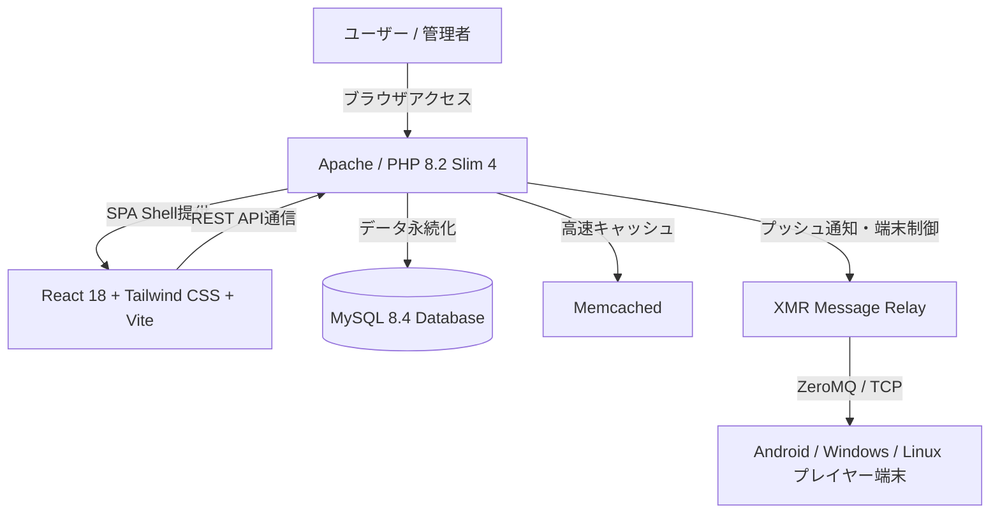
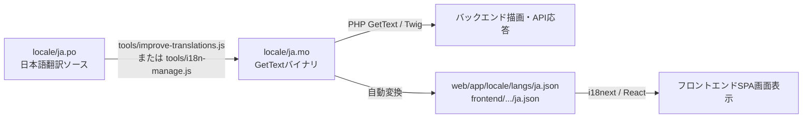

# Xibo CMS 4.5.1 アーキテクチャ解説書

## 1. システム全体概要
Xibo CMS（Content Management System）は、オープンソースのデジタルサイネージ配信・端末管理プラットフォームです。
v4.5.1 では、バックエンドに Slim 4 (PHP 8.2+)、フロントエンドに React 18 + TypeScript + Vite + Tailwind CSS を採用したモダンなデュアル構成となっています。



---

## 2. ディレクトリ構造

```
d:\develop\xibo4.5.1/
├── bin/                    # CLIスクリプト（locale.php, xtr.php 等）
├── containers/             # Dockerコンテナ永続化データ（containers/db 等）
├── custom/                 # カスタムモジュール・ミドルウェア拡張用
├── db/                     # Phinxデータベースマイグレーション
├── docker/                 # コンテナ用設定ファイル・エントリーポイント
├── docs/                   # プロジェクト設計書・ローカライズ・運用手順書
├── frontend/               # 新UIフロントエンド（React 18, Vite, Tailwind CSS）
│   ├── public/locale/      # 生成されたi18n言語パック（langs/ja.json 等）
│   ├── src/                # Reactコンポーネント・ページ・フック
│   └── scripts/            # MO -> JSON 変換スクリプト
├── lib/                    # バックエンドPHPコード
│   ├── Controller/         # REST APIコントローラー
│   ├── Entity/             # データモデル
│   ├── Factory/            # データアクセス層
│   ├── Service/            # ビジネスロジック
│   └── Widget/             # ウィジェット定義
├── locale/                 # 多言語GetText辞書ファイル
│   ├── ja.po               # 日本語ソース辞書（編集可能テキスト）
│   ├── ja.mo               # コンパイル済みバイナリ辞書
│   └── default.pot         # 翻訳テンプレート
├── tools/                  # 日本語ローカライズ管理・解析・更新ツール
├── views/                  # Twigテンプレート（バックエンド描画用）
├── web/                    # ドキュメントルート
│   ├── app/                # ビルド済みReact SPA静的ファイル
│   ├── index.php           # Webエントリーポイント
│   └── settings.php        # CMS設定ファイル
├── docker-compose.yml      # 自己ホスティング・開発用Docker構成
└── .env                    # 環境変数（ポート、JSTタイムゾーン等）
```

---

## 3. 多言語（i18n / ローカライズ）のデータフロー



1. **バックエンド側**: `locale/ja.mo` を PHP の GetText 拡張および Twig の `trans` フィルターが読み込み、サーバーサイドレンダリングやAPIエラーメッセージを日本語化します。
2. **フロントエンド側**: `locale/ja.mo` から自動抽出された `ja.json` を Vite/React の `react-i18next` がロードし、画面上のUIテキストを日本語化します。
3. **同期の完全性**: `tools/improve-translations.js` または `tools/i18n-manage.js` を実行することで、PO → MO → JSON が一括同期され、翻訳のズレが起きない仕組みになっています。
